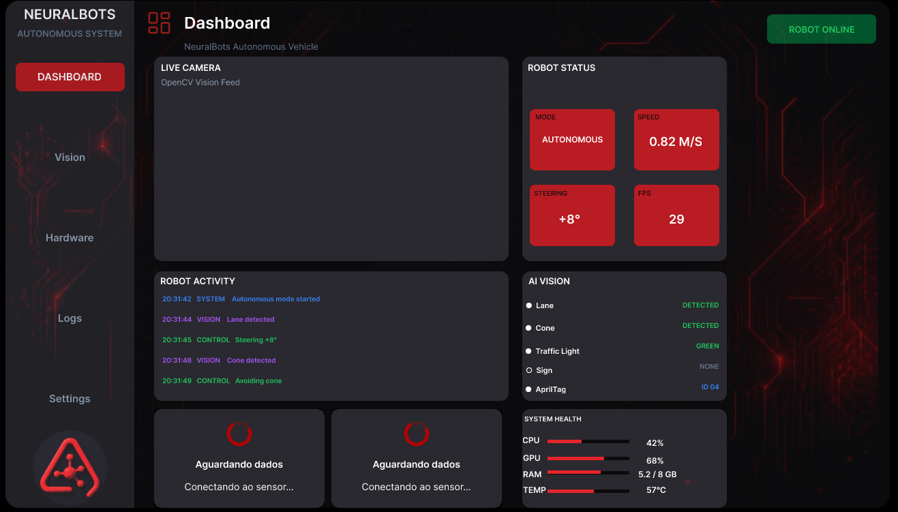

# NeuralBots Dashboard

Interface de monitoramento e controle da **NeuralBots**, projetada no Figma para integração com ROS 2, visão computacional e robótica autônoma.

> **Status:** em desenvolvimento. O protótipo visual está sendo planejado antes da implementação do aplicativo e da integração com o ROS 2.

## Sobre o projeto

O NeuralBots Dashboard será uma interface gráfica desktop para acompanhar o estado do robô e facilitar a visualização de dados durante o desenvolvimento e a operação. A proposta é oferecer uma experiência organizada, com foco em uso local e funcionamento offline.

### Funcionalidades planejadas

- **Dashboard:** visão geral do estado do robô e da telemetria.
- **Vision:** visualização da câmera e de informações de visão computacional.
- **Hardware:** acompanhamento dos componentes e sensores.
- **Logs:** consulta de eventos, mensagens e erros do sistema.
- **Settings:** configurações de operação e parâmetros do sistema.
- **Integração com ROS 2:** comunicação com os nós do robô para receber dados e, futuramente, enviar comandos com validações de segurança.
- **Operação local/offline:** objetivo de funcionar na rede local sem depender de serviços na nuvem.

As funcionalidades acima são objetivos de desenvolvimento; elas não significam que já estejam implementadas.

## Prévia do design

As capturas de tela do protótipo podem ser adicionadas à pasta `docs/`.

| Tela | Prévia |
|---|---|
| Dashboard | `docs/dashboard.png` |
| Vision | `docs/vision.png` |
| Hardware | `docs/hardware.png` |
| Logs | `docs/logs.png` |
| Settings | `docs/settings.png` |

Quando as imagens forem adicionadas ao repositório, você pode exibi-las diretamente nesta seção. Por exemplo:

```md

```

## Protótipo no Figma

O design é desenvolvido no Figma. Consulte [`design/figma-link.md`](design/figma-link.md) para acessar o link do protótipo.

## Estrutura do repositório

```text
NeuralBots-Dashboard/
├── README.md
├── docs/
│   ├── dashboard.png
│   ├── vision.png
│   ├── hardware.png
│   ├── logs.png
│   └── settings.png
├── design/
│   └── figma-link.md
├── src/              # Código do aplicativo (futuramente)
├── config/           # Arquivos de configuração (futuramente)
└── LICENSE
```

## Tecnologias previstas

- **Python** — linguagem principal prevista para o aplicativo.
- **PySide6 / Qt** — interface gráfica desktop.
- **ROS 2** — comunicação com os módulos do robô.
- **OpenCV / YOLO** — recursos de visão computacional, conforme a arquitetura final.

A seleção e as versões das tecnologias serão confirmadas durante a implementação.

## Desenvolvimento

O projeto está em fase de planejamento e prototipação visual. As instruções de instalação e execução serão adicionadas quando a estrutura do aplicativo estiver implementada.

## Segurança

Os comandos de controle do robô deverão ser integrados com validações de segurança. Durante o desenvolvimento, testes com dados simulados devem ser priorizados antes de qualquer acionamento de motores.

## Licença

A licença será definida no arquivo [`LICENSE`](LICENSE). Até que ela seja adicionada e publicada, não presuma que o conteúdo esteja disponível para reutilização sob uma licença de código aberto.
